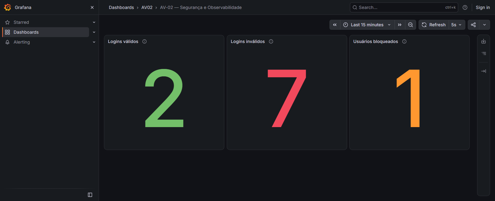
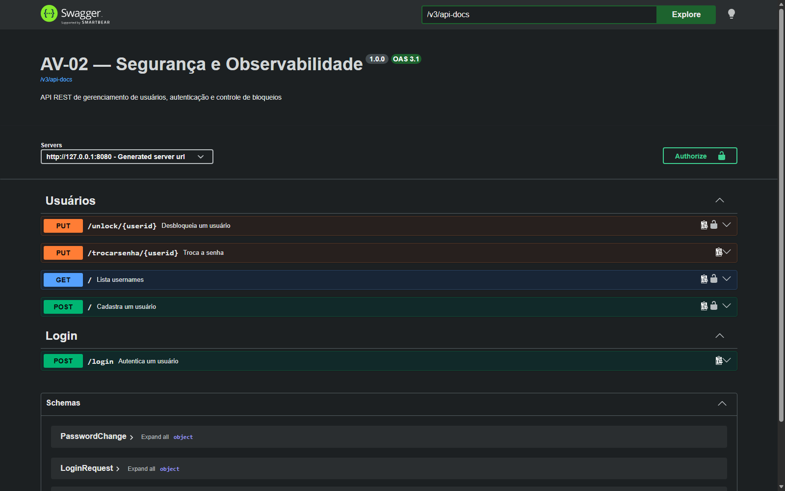

# AV02 — Segurança e Observabilidade

Etapas 1 a 7: estrutura Spring Boot 4.1.1, Java alvo 17, JDBC, Spring Security,
H2 em arquivo, login, bloqueio, gerenciamento de usuários, métricas, Prometheus e Grafana.
O enunciado original está em `ENUNCIADO.md` e foi preservado.
Os cinco endpoints do enunciado e os três indicadores estão implementados.
Prometheus e dashboard Grafana estão integrados em ambiente local isolado.
Os cinco endpoints também possuem documentação OpenAPI e Swagger UI.

## Etapa 6 — Prometheus e Grafana

**Etapa 6 concluída e validada.** Prometheus **3.13.5 LTS** e Grafana OSS
**13.2.4**, com coleta e atualização automática a cada **5 segundos**.
O target Prometheus foi validado como **UP** e a fonte Grafana como **OK**.



Valores registrados na captura, coincidentes no Actuator, no Prometheus e no Grafana:

| Indicador | Valor |
|---|---:|
| Logins válidos | 2 |
| Logins inválidos | 7 |
| Usuários bloqueados | 1 |

Os painéis Stat usam consultas instantâneas. Os Counters de login acumulam eventos
desde o início da aplicação; o Gauge mostra o número atual de contas bloqueadas.
Os valores mudam ao gerar novos eventos e os Counters reiniciam com a aplicação.

Foram validados eventos reais de login, falhas, bloqueio, desbloqueio e HTTP Basic;
atualização automática; reinício com persistência; exportação oficial e reimportação
do dashboard. **91 testes foram aprovados**, incluindo as duas fases de persistência
executadas separadamente. A demonstração utiliza um H2 isolado e credenciais fictícias.

- [Dashboard JSON exportado e importável](observability/dashboard/av02-dashboard.json)
- [Screenshot real em PNG](observability/evidence/dashboard-grafana.png)
- [Guia de instalação, execução e importação](observability/README.md)
- [Relatório completo e evidências de validação](ETAPA6_VALIDACAO.md)

Para iniciar, execute no PowerShell 7, dentro de AV02 na unidade D: (compile com
`.\dev.ps1 package` se o JAR ainda não existir):

```powershell
.\observability\install.ps1
.\observability\stack.ps1 start
.\observability\demo.ps1
.\observability\verify.ps1
```

| Serviço | Endereço local |
|---|---|
| API de demonstração | http://127.0.0.1:8080 |
| Actuator | http://127.0.0.1:9099/actuator/prometheus |
| Prometheus | http://127.0.0.1:9090/targets |
| Grafana | http://127.0.0.1:3000/d/av02-seguranca-observabilidade |

Esses endereços funcionam na máquina onde a stack está iniciada. Downloads,
instalações adicionais, caches, temporários e dados ficam em D:, sob `.local`.
O banco principal e a AV01 foram preservados. Para encerrar, preservando os dados:

```powershell
.\observability\stack.ps1 stop
```

A Etapa 6 foi concluída. A documentação OpenAPI/Swagger está descrita a seguir.

## Ambiente Windows

### OpenAPI e Swagger UI — Etapa 7

Dependência `springdoc-openapi-starter-webmvc-ui` **3.1.1**, conforme o exemplo do
professor, mantendo Spring Boot 4.1.1 e Java alvo 17.

Com a aplicação em execução:

- Swagger UI: http://127.0.0.1:8080/swagger-ui/index.html
- JSON OpenAPI: http://127.0.0.1:8080/v3/api-docs
- YAML OpenAPI: http://127.0.0.1:8080/v3/api-docs.yaml
- `/swagger-ui.html` redireciona com HTTP 302 para `/swagger-ui/index.html`.

| Operação | Acesso | Respostas documentadas |
|---|---|---|
| `POST /login` | Público | 200, 400, 401 |
| `PUT /trocarsenha/{userid}` | Público; valida a senha atual | 204, 400, 401 |
| `POST /` | HTTP Basic, ROLE_MANUTENCAO | 201, 400, 401, 403, 409 |
| `PUT /unlock/{userid}` | HTTP Basic, ROLE_ADMIN | 204, 401, 403, 404 |
| `GET /` | HTTP Basic, ROLE_MANUTENCAO | 200, 401, 403 |

`userid` corresponde ao username. A listagem mantém o formato existente:
`[{"username":"usuario-exemplo"}]`, contendo somente usernames. As demais respostas
de negócio não têm corpo. As senhas dos exemplos da documentação são fictícias.

Para testar no Swagger, use **Try it out**, preencha o corpo e clique em **Execute**.
O botão **Authorize** fornece HTTP Basic apenas às operações protegidas;
as roles continuam sendo verificadas pelo Spring Security. Login não cria sessão
nem token. A autorização não é persistida pela interface.

Use a stack de `observability` para operações de demonstração com banco isolado.
Não execute tentativas incorretas ou alterações de usuários no banco principal.
As credenciais fictícias da stack permanecem protegidas em `.local`; nunca copie
senhas para o README, screenshots ou arquivos de evidência. A interface pode exibir
o corpo e o cabeçalho Authorization ao executar uma chamada: não compartilhe essa
tela sem antes limpar a autorização e recarregar a página.

Apenas os caminhos GET necessários à documentação foram liberados; as permissões
de negócio e o Actuator em `127.0.0.1:9099` continuam preservados. Consulte
[o relatório da Etapa 7](ETAPA7_VALIDACAO.md) para testes, evidências e limitações.

[Especificação JSON gerada](docs/openapi.json) ·
[Evidência dos testes pela interface](docs/evidence/swagger-ui.json)



Antes de recompilar o JAR no Windows, encerre a stack com
`.\observability\stack.ps1 stop`; depois do build, inicie-a novamente com `start`.

Execute na pasta AV02, na unidade D:. O script `dev.ps1` usa o JDK 21 existente
em `C:\Program Files\Java\jdk-21` e o Maven existente em
`D:\!Theo\dev\maven\apache-maven-3.9.9`. Nenhuma instalação adicional é necessária.
Ajuste esses dois caminhos no script se o ambiente mudar.

```powershell
.\dev.ps1 test
.\dev.ps1 package
.\dev.ps1 run
```

O script direciona o repositório Maven para `.local/m2/repository`, TEMP/TMP e
`java.io.tmpdir` para `.local/tmp`, e fixa o diretório de trabalho em AV02.
Builds e relatórios ficam em `target/`. Execute pelo script para manter esses
arquivos na unidade D:. A API escuta somente em `127.0.0.1:8080`.
Cada execução do script pode ser feita em um terminal dedicado: ele configura
as variáveis de ambiente desse processo, sem modificar configurações do Windows.

## Usuários locais de teste

As contas opcionais são `admin` (somente `ROLE_ADMIN`) e `manutencao`
(somente `ROLE_MANUTENCAO`). Não há senha padrão no código ou no SQL.
Antes de iniciar pela primeira vez, informe senhas locais descartáveis:

```powershell
$av02AdminSecret = Read-Host 'Senha local de admin' -AsSecureString
$av02MaintenanceSecret = Read-Host 'Senha local de manutencao' -AsSecureString
$env:AV02_ADMIN_PASSWORD = [System.Net.NetworkCredential]::new('', $av02AdminSecret).Password
$env:AV02_MANUTENCAO_PASSWORD = [System.Net.NetworkCredential]::new('', $av02MaintenanceSecret).Password
try {
    .\dev.ps1 run
} finally {
    Remove-Item Env:AV02_ADMIN_PASSWORD, Env:AV02_MANUTENCAO_PASSWORD -ErrorAction SilentlyContinue
}
```

As senhas são recebidas em memória e persistidas somente como `{bcrypt}` + hash.
Não são impressas nos logs. Sem as variáveis, nenhuma conta é criada.
Usuários existentes nunca são substituídos, mesmo se as variáveis mudarem.
Não use senhas reais e não versione arquivos de credenciais ou o banco.

## Banco e segurança inicial

O banco fica em `data/av02.mv.db`, relativo à pasta AV02. O datasource usa H2
embutido, usuário local `sa` e senha opcional `AV02_DB_PASSWORD` (vazia por padrão).
Não há servidor TCP nem console web do H2 habilitado.

`schema.sql` usa somente `CREATE TABLE IF NOT EXISTS`, sem DROP, TRUNCATE
ou carga que reponha dados. `spring.sql.init.mode=always` garante inicialização
do schema também no banco em arquivo. Não execute duas instâncias no mesmo banco.

- `usuarios`: única fonte de credenciais; `senha VARCHAR(100)` comporta o hash.
- `enabled`: campo adicional para compatibilidade com leitura e escrita do gerenciador JDBC.
- `authorities`: roles com chave estrangeira para `usuarios`.
- `login_attempts`: contador de falhas consecutivas, estado de bloqueio e timestamps.

O `JdbcUserDetailsManager` tem SQL de consulta, existência, cadastro, atualização,
exclusão, troca de senha e manutenção de authorities configurados explicitamente.
Cadastro e atualizações usam transações. O método `changePassword` do gerenciador
JDBC continua coberto pelo teste da Etapa 1; o endpoint público de troca usa
JdbcTemplate para atualizar exclusivamente o hash do username solicitado, após
validar a senha atual. Isso evita depender do principal de uma sessão ou de HTTP Basic.

HTTP Basic e autorização por método/rota estão preparados; formulário de login
desativado e sessões stateless. CSRF está desativado para os testes da API REST
local, sem frontend nesta etapa. As rotas públicas previstas são `POST /login`
e `PUT /trocarsenha/{userid}`. Cadastro e listagem exigem MANUTENCAO;
desbloqueio exige ADMIN; demais acessos são negados. ADMIN não implica MANUTENCAO.

## Login — Etapa 2

Envie `POST http://127.0.0.1:8080/login` com `Content-Type: application/json`:

```json
{"username":"admin","senha":"sua-senha-local"}
```

Não é necessário cabeçalho `Authorization`. As respostas têm corpo vazio:

- `200`: credenciais válidas;
- `401`: credenciais inválidas, igualmente para usuário inexistente ou senha incorreta;
- `400`: JSON malformado, corpo ausente ou username/senha ausentes, nulos, vazios ou somente espaços.

O controller delega ao `LoginService`, que chama o `AuthenticationManager`
do Spring Security. Ele utiliza o `JdbcUserDetailsManager` para ler `usuarios`
e `authorities` e o `PasswordEncoder` para conferir BCrypt. Não existe comparação
manual de senhas ou nova consulta SQL no controller.

O resultado não é salvo no contexto de segurança nem em sessão. O login não
emite token e não autentica chamadas seguintes: elas continuam usando HTTP Basic
quando exigido. Contas bloqueadas também recebem 401, sem informar o motivo.
O tratamento local de erros de JSON e validação retorna somente 400, sem imprimir
o corpo da requisição, senhas ou hashes.

## Tentativas e bloqueio — Etapa 3

Para usuários existentes, a primeira chamada a `/login` cria, se necessário, uma
linha em `login_attempts`. Primeira senha incorreta: contador 1, desbloqueado.
Segunda senha incorreta consecutiva: contador 2 e `locked=true`. São preenchidos
`last_failed_at`, `locked_at` quando aplicável, e `updated_at`.
Usuários inexistentes não criam registros.

Um login correto antes do bloqueio zera o contador, limpa as datas de falha e
bloqueio e atualiza `updated_at`. Contas já bloqueadas continuam em 401, sem
aumentar o contador ou alterar as datas. Não existe desbloqueio automático.

`LoginService.login` usa uma transação e `SELECT ... FOR UPDATE` na linha de
`usuarios` para serializar logins do mesmo usuário, inclusive quando ainda não
existe registro em `login_attempts`. O incremento é feito no próprio SQL.
As exceções de autenticação são capturadas dentro do serviço: ele retorna false
e permite o commit das falhas antes do controller responder 401.
Falhas na gravação das tentativas propagam como erro e provocam rollback.

Um único `DaoAuthenticationProvider` usa o gerenciador JDBC e o BCrypt existentes
e consulta o bloqueio antes de validar a senha. Assim, o mesmo AuthenticationManager
recusa contas bloqueadas tanto no login JSON quanto no HTTP Basic. O campo
`enabled` não é duplicado como estado de bloqueio. HTTP Basic não incrementa nem
zera tentativas de `/login`. Roles e regras de acesso permanecem iguais.

As dependências resolvidas são Spring Boot 4.1.1 e **Spring Security 7.1.1**.
O aviso de autoconfiguração sobre provider explícito é esperado: o provider
configurado recebe diretamente o `JdbcUserDetailsManager` existente.

## Gerenciamento de usuários — Etapa 4

`userid` significa `username` em todas as rotas. Respostas de escrita e erro
têm corpo vazio. Somente a listagem retorna JSON.

| Método e rota | JSON | Permissão | Status |
|---|---|---|---|
| POST /login | `{"username":"ana","senha":"..."}` | Público | 200, 401, 400 |
| PUT /trocarsenha/{userid} | `{"atual":"...","nova":"..."}` | Público; exige senha atual correta | 204, 401, 400 |
| POST / | `{"username":"ana","senha":"..."}` | ROLE_MANUTENCAO via Basic | 201, 409, 400, 401, 403 |
| PUT /unlock/{userid} | Sem corpo | ROLE_ADMIN via Basic | 204, 404, 401, 403 |
| GET / | Sem corpo | ROLE_MANUTENCAO via Basic | 200, 401, 403 |

Cadastros usam `JdbcUserDetailsManager.createUser` e BCrypt em uma transação.
O username deve ser não vazio e ter até 100 caracteres. Novas senhas (cadastro e
troca) devem ser não vazias e ter até **72 bytes em UTF-8**, limite do BCrypt.
Dados inválidos retornam 400, incluindo JSON malformado e campos ausentes/nulos.
Duplicidade de username retorna 409, inclusive em cadastros simultâneos; a chave
primária do banco impede duplicação e a transação evita dados parciais.

**Decisão necessária:** contas criadas recebem somente `ROLE_USER`. O gerenciador
JDBC exige ao menos uma authority para carregar um usuário; essa role não concede
nenhuma operação administrativa. Campos extras como `roles`, `authorities` e
`enabled` enviados no JSON são ignorados e nunca aplicados. Não há endpoint para
gerenciar roles. Uma conta comum pode autenticar no login, mas recebe 403 ao tentar
cadastrar, listar ou desbloquear.

A troca de senha valida o hash atual e salva somente o novo hash. Usuário inexistente
e senha atual incorreta retornam o mesmo 401. A operação pode ocorrer mesmo numa
conta bloqueada, mas não modifica `login_attempts`, não desbloqueia e não zera
falhas. A senha antiga deixa de funcionar. Trocas simultâneas com a mesma senha
atual são serializadas: somente a primeira pode usá-la com sucesso.

O desbloqueio retorna 204 inclusive para conta já desbloqueada, e 404 para username
inexistente. Zera o contador, limpa last_failed_at/locked_at, altera locked para false
e atualiza updated_at, preservando hash, roles, enabled e outros usuários. Se ainda
não existe registro de tentativas, não precisa criá-lo. Não há desbloqueio automático.

Troca de senha, desbloqueio e login usam `SELECT ... FOR UPDATE` sobre a mesma
linha de `usuarios`, em transações, evitando atualizações concorrentes inconsistentes.
A política central de bloqueio também protege cadastro, listagem e desbloqueio:
contas bloqueadas recebem 401 antes de executar essas operações.

A listagem usa uma consulta que seleciona **somente username** e retorna, em ordem:
`[{"username":"ana"}]`. Sem usuários, o resultado é `[]`; senhas, hashes e dados
de tentativas não são selecionados nem serializados.

## Métricas e Actuator — Etapa 5

Foram adicionadas somente `spring-boot-starter-actuator` e
`micrometer-registry-prometheus`, com versões gerenciadas pelo Spring Boot 4.1.1.
A implementação segue o componente com Counter e injeção no controller dos
[exemplos do professor](https://github.com/esensato/ms-2026-02#actuator).

| Tipo | Nome no Micrometer | Nome realmente exportado no Prometheus |
|---|---|---|
| Counter | `av02.login.success` | `av02_login_success_total` |
| Counter | `av02.login.failure` | `av02_login_failure_total` |
| Gauge | `av02.users.locked` | `av02_users_locked` |

O Micrometer transforma os pontos em underscores e acrescenta `_total` aos
Counters. Os nomes acima foram confirmados por requisições HTTP reais ao endpoint.
As três métricas são registradas na inicialização, inclusive com contagem zero,
sem labels individuais, usernames ou credenciais.

`LoginController.login` chama `LoginMetrics.recordLogin` exatamente uma vez após
o retorno de `LoginService.login`, quando a transação já foi concluída. Sucesso
incrementa somente o Counter de válidos; retorno falso incrementa somente o de
inválidos. Senha incorreta, username inexistente e conta bloqueada retornam 401 e
são contabilizados. JSON/dados inválidos (400), chamadas HTTP Basic e outras
operações não passam por esse ponto de contagem. Requisições rejeitadas pelo filtro
Basic antes de processar o corpo do login também não são tentativas processadas.

O Gauge executa `SELECT COUNT(*) FROM login_attempts WHERE locked = TRUE` a cada
leitura. Representa o estado atual, aumenta ao bloquear e diminui ao desbloquear;
não acumula eventos nem usa uma variável em memória como fonte de verdade.
Falhas transacionais de gravação não chegam à contagem do controller.

Os Counters acumulam desde a inicialização e **reiniciam com o processo**.
O Gauge continua correto após reinício porque consulta o banco persistente.
Não foram criadas tabelas de métricas. A coleta histórica pelo servidor Prometheus
será configurada somente na próxima etapa.

### Endpoint local de coleta

A API continua em `127.0.0.1:8080`. O Actuator tem listener separado em
`127.0.0.1:9099`, conforme o suporte a porta/endereço de gerenciamento do
[Spring Boot](https://docs.spring.io/spring-boot/reference/actuator/monitoring.html).
Somente GET `/actuator/prometheus` é liberado para coleta local, sem Basic.
A cadeia específica usa EndpointRequest; as regras das APIs permanecem iguais.
Discovery de endpoints foi desabilitado e somente `prometheus` está na exposição
HTTP: health, env, configprops, heapdump e metrics não foram expostos.

Com a aplicação em execução:

```powershell
Invoke-WebRequest http://127.0.0.1:9099/actuator/prometheus
```

Amostra real obtida nos testes após um sucesso e duas falhas que bloquearam uma conta:

```text
av02_login_failure_total 2.0
av02_login_success_total 1.0
av02_users_locked 1.0
```

O endpoint também inclui as métricas técnicas padrão do Actuator/Micrometer.
A Etapa 6 abaixo acrescenta o servidor Prometheus e o Grafana, sem alterar a API.
Swagger ainda não foi implementado.

## Prometheus e dashboard Grafana — Etapa 6

O ambiente usa Prometheus **3.13.5 LTS** e Grafana OSS **13.2.4** portáteis,
instalados somente em `.local/observability/`, na unidade D:. Docker não é necessário.
O [guia de reprodução](observability/README.md) documenta pré-requisitos,
armazenamento, credenciais fictícias protegidas, portas, importação e encerramento.

```powershell
.\observability\install.ps1
.\observability\stack.ps1 start
.\observability\demo.ps1
.\observability\verify.ps1
```

A stack inicia sua própria aplicação com banco H2 de demonstração separado;
não rode `dev.ps1 run` junto dela, pois ambos usam a porta 8080.
Nenhuma operação de demonstração usa `data/av02.mv.db`.

- API isolada: http://127.0.0.1:8080
- Actuator: http://127.0.0.1:9099/actuator/prometheus
- Target Prometheus: http://127.0.0.1:9090/targets
- [Dashboard Grafana](http://127.0.0.1:3000/d/av02-seguranca-observabilidade)

O job `av02` coleta a cada 5 segundos. Os três painéis **Stat** usam consultas
instantâneas das métricas de sucesso, falha e bloqueio, filtradas por job e
instância única. Não usam rate, média temporal, soma duplicada nem zeros artificiais.
O dashboard atualiza automaticamente a cada 5 segundos e mantém a semântica:
Counters desde o início do processo; Gauge atual persistente.

Arquivos de entrega:

- [JSON exportado oficialmente pelo Grafana](observability/dashboard/av02-dashboard.json)
- [Screenshot real do Grafana](observability/evidence/dashboard-grafana.png)
- [Relatório de validação](ETAPA6_VALIDACAO.md)
- [Evidências de integração](observability/evidence/)

Para importar o JSON em outro Grafana, abra Dashboards > New > Import, selecione
o arquivo e associe a fonte de dados Prometheus configurada no destino. O arquivo
foi exportado no modelo Classic, com compartilhamento entre instâncias habilitado.
Para parar sem apagar bancos/histórico:

```powershell
.\observability\stack.ps1 stop
```

## Validação de persistência entre JVMs

Os testes iniciam a API e a porta de gerenciamento em portas aleatórias para
evitar conflitos entre os contextos Spring. A execução normal usa as portas abaixo.

```powershell
.\dev.ps1 persistence-write
.\dev.ps1 persistence-read
Remove-Item Env:AV02_RESTART_TEST_PASSWORD
```

Cada comando inicia uma JVM e um servidor Spring Boot em porta aleatória.
Execute os dois comandos no mesmo terminal. O script gera uma senha aleatória
apenas no ambiente do processo, compartilhada entre as duas JVMs, sem gravá-la em disco.
O primeiro grava usuários BCrypt, roles, uma fixture de datas e bloqueia outro
usuário por duas chamadas reais a `/login`. O segundo reabre o mesmo banco,
compara credenciais, estado e datas preservados e confirma que a senha correta
é rejeitada pelo AuthenticationManager, `/login` e HTTP Basic.
Também verifica que cadastro, troca de senha e desbloqueio permanecem após reinício,
com a nova senha autenticando e a senha antiga inválida.
Antes do primeiro login da segunda JVM, verifica que os Counters voltaram a zero
e que o Gauge/exportação HTTP continuam indicando os dois bloqueios persistidos
nas fixtures. Amostras reais são salvas em `.local/etapa5-prometheus-sample.prom`
e `.local/etapa5-restart-prometheus-sample.prom`.
O banco de teste fica em `.local/persistence-check/`, separado de `data/av02`.
As senhas de teste são aleatórias e ficam apenas em memória; o checkpoint local
contém hashes e nunca é versionado. O banco normal não participa dos testes.

`test` executa os testes de login (incluindo validação, ausência de sessão e
credenciais nos logs), tabelas, BCrypt, operações do gerenciador JDBC e HTTP
401/403 e concorrência (duas falhas simultâneas, repetidas cinco vezes).
O teste entre reinícios exige os dois comandos explícitos acima.
Os testes de gerenciamento cobrem os quatro endpoints, matriz de roles, ausência
de dados sensíveis e concorrência em cadastro, troca de senha e desbloqueio.
Os testes de métricas comparam deltas dos Counters e também os valores exportados
por HTTP, sem depender da ordem dos cenários ou alterar o banco normal.

Etapa 8 — Revisão e entrega será iniciada somente após autorização.
A publicação das Etapas 1 a 6 neste repositório foi autorizada após a validação.
